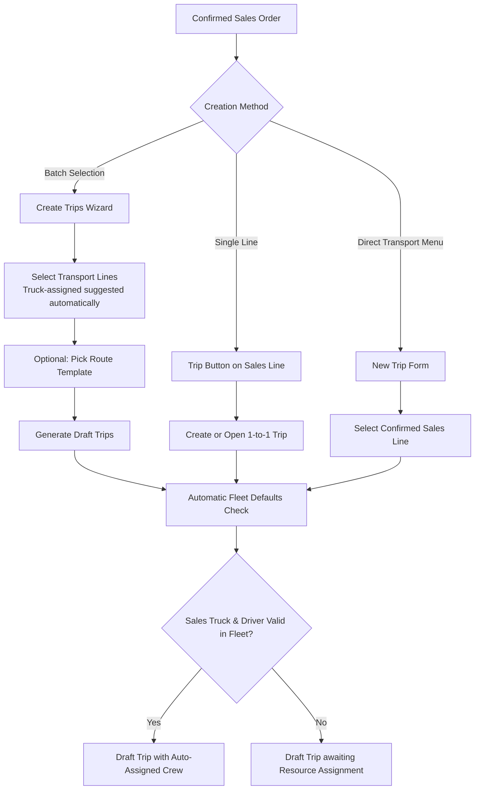
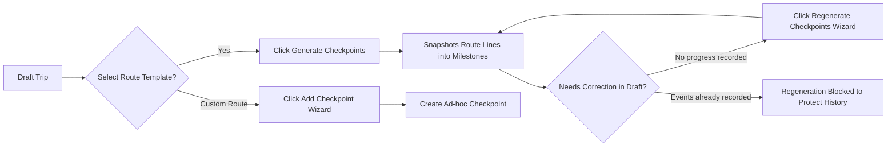
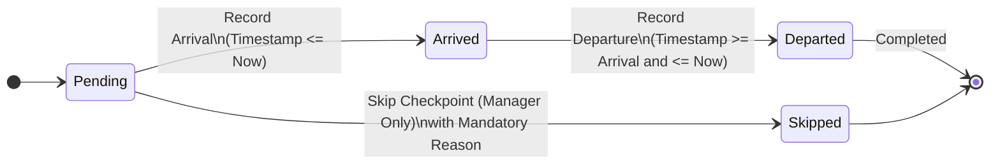
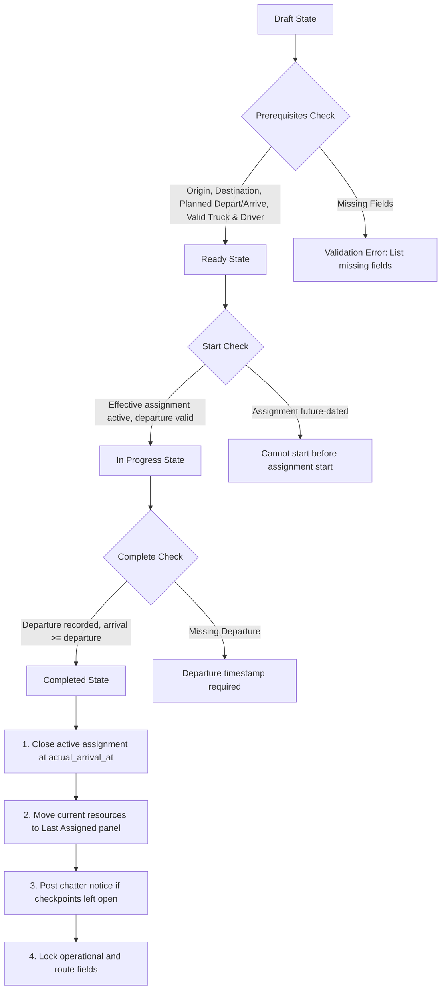
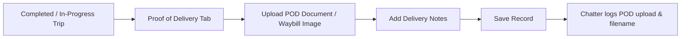

# TAJ Transport Operations — Comprehensive User Flow & Feature Guide

## 1. Executive Summary & Architecture Principles

The **TAJ Transport Operations** module (`taj_transport_operations`) manages end-to-end trucking logistics, fleet allocations, route checkpoint execution, and Proof of Delivery (POD) inside Odoo.

### Key Architectural Pillars
- **Strict Separation of Operational vs. Financial Records:** Trips do not alter Sales, Invoices, Purchase Orders, or Accounting entries. Unit prices, customer references, and payment terms remain owned by Sales.
- **One-to-One Sales Order Line Link:** Each confirmed product/service Sales Order line corresponds to exactly one operational trip, strictly enforced by a database constraint (`UNIQUE(sale_line_id)`).
- **Snapshot Integrity:** Historical values (such as the truck initially specified on the sales order, or checkpoint types from templates) are snapshotted at creation. Future modifications in Fleet or Templates never retroactively corrupt past trips.
- **Immutable Audit Trails:** Resource assignments and checkpoint events cannot be directly updated or deleted from the database. Every modification produces an explicit, timestamped, and user-attributed event.
- **Strict Chronological Controls:** Arrival cannot precede departure, start cannot precede assignment, and resource replacements cannot be retroactively backdated before previous assignment starts.

---

## 2. User Roles & Permissions Matrix

The module introduces two primary security groups under the **Transport Operations** privilege category:

| Feature / Action | Dispatcher (`group_transport_user`) | Transport Manager (`group_transport_manager`) | Fleet Officer / Admin | Sales User |
| :--- | :---: | :---: | :---: | :---: |
| **View Trips & Milestones** | Yes (Own company) | Yes (Own company) | Read-only if in Transport | Read-only if in Transport |
| **Create Trips from Sales** | Yes | Yes | No | No (Requires Transport group) |
| **Assign Initial Resources** | Yes | Yes | No | No |
| **Replace Active Resources** | Yes | Yes | No | No |
| **Edit Operational Data** (Route, Cargo, Transporter) | Yes (Draft/Ready/In Progress) | Yes (Draft/Ready/In Progress) | No | No |
| **Mark Ready / Start Trip / Complete Trip** | Yes | Yes | No | No |
| **Cancel Trip in Draft / Ready** | Yes (Reason mandatory) | Yes (Reason mandatory) | No | No |
| **Cancel Trip in Progress** | ❌ No | Yes (Reason mandatory) | No | No |
| **Record Checkpoint Arrival / Departure** | Yes | Yes | No | No |
| **Skip Checkpoints** | ❌ No | Yes (Reason mandatory) | No | No |
| **Correct Checkpoint Timestamps** | ❌ No | Yes (Reason mandatory) | No | No |
| **Manage Catalogs** (Cargo Types, Transporters, Route Templates, Checkpoint Types) | ❌ Read-only | Yes (Full CRUD) | No | No |
| **Create / Recategorize Fleet Vehicles & Trailers** | ❌ Read-only | ❌ Read-only | Yes (Fleet App) | No |

---

## 3. High-Level Lifecycle & State Machine

```mermaid
stateDiagram-v2
    [*] --> Draft: Created from Sales Line / Wizard

    Draft --> Ready: Mark Ready\n(Truck, Driver, Origin, Dest, Planned Times validated)
    Ready --> In_Progress: Start Trip\n(Stamps started_at & actual_departure_at)
    In_Progress --> Completed: Complete Trip\n(Stamps completed_at & actual_arrival_at;\nreleases resources)

    Draft --> Cancelled: Cancel Trip (Dispatcher / Manager)\nwith Reason
    Ready --> Cancelled: Cancel Trip (Dispatcher / Manager)\nwith Reason
    In_Progress --> Cancelled: Cancel Trip (Manager Only)\nwith Reason

    Completed --> [*]
    Cancelled --> [*]
```



---

## 4. Master Data & Catalog Management (Manager Setup)

Before executing daily transport operations, Transport Managers configure master catalogs under **Transport Operations > Configuration**:

```
Transport Operations
├── Trips
├── Milestones
├── Vehicle Availability
└── Configuration
    ├── Cargo Types
    ├── Route Templates
    ├── Checkpoint Types
    └── Transporters
```

### 4.1. Transporters (`taj.transport.transporter`)
- Catalog of third-party or internal transport entities.
- Fields: **Name** (required), **Email**.
- *System Default Behavior:* The transporter named `TAJ` (case-insensitive) is automatically preselected as default on all new trips.

### 4.2. Cargo Types (`taj.transport.cargo.type`)
- Standardized classifications of freight (e.g., *Bulk, Containerized, Dangerous Goods, Refrigerated, General Cargo*).
- Transport Managers add/archive types. Renaming in-use categories is guarded.

### 4.3. Checkpoint Types (`taj.transport.milestone.type`)
- Classifies journey stops (e.g., *Arrival at Site, Loading, Departure, Border Crossing, Destination Arrival, Offloading*).
- Standalone snapshots: Renaming a checkpoint type does not alter existing milestone records.

### 4.4. Route Templates (`taj.transport.route`)
- Standard templates holding ordered checkpoint lines (`taj.transport.route.line`).
- Checkpoint fields: **Sequence**, **Name**, **Milestone Type**, **Planned Offset (Days / Hours)** (e.g., 12 hours = 0.5 days), **Latitude / Longitude**, **Notes**.
- Isolated per company.

---

## 5. End-to-End Operational User Flows

### Flow 1: Trip Initiation & Creation

Trips originate from confirmed Sales Orders (`sale` or `done` state).



#### Step-by-Step:
1. **Sales Order Header > "Create Trips":**
   - Opens `taj.transport.trip.create.wizard`.
   - Pre-selects order lines having an assigned truck.
   - If lines have no truck, a yellow warning explains that a truck must be
     assigned on the Sales order lines before a trip can be created.
   - An optional **Route Template** can be chosen upfront for batch generation.
   - Clicking **Create Trips** generates the records and redirects to the trip view.
2. **Sales Order Line > "Trip" Button:**
   - Immediately checks whether a trip exists for this line.
   - If missing, creates exactly one `Draft` trip and navigates to its form view.
3. **Product Name Route Extraction:**
   - If the Sales product template name contains a separator (e.g., `DRC Kasumbalesa - TZ Dar (40ft)`), `Origin` (`DRC Kasumbalesa`) and `Destination` (`TZ Dar`) are automatically extracted, ignoring container specifications in parentheses.

---

### Flow 2: Resource Assignment & Crew Management

Every trip requires an active Fleet truck and primary driver before it can depart.

```mermaid
sequenceDiagram
    autonumber
    actor Dispatcher
    participant Form as Trip Form
    participant Wiz as Assignment Wizard
    participant DB as Assignment History (PostgreSQL)

    alt Automatic Assignment
        Form->>DB: Validates initial_vehicle_id & Fleet Driver
        DB-->>Form: Creates initial assignment row automatically
    else Manual Initial Assignment
        Dispatcher->>Form: Clicks "Assign Initial Resources"
        Form->>Wiz: Opens Assignment Wizard (pre-suggests sales truck & driver)
        Dispatcher->>Wiz: Selects Trailer, Driver, Co-Driver, Effective From, Reason
        Dispatcher->>Wiz: Clicks "Assign Initial Resources"
        Wiz->>DB: Inserts immutable row (effective_to = NULL)
        DB-->>Form: Tab updates: "Current Assignment" active
    end

    opt Resource Replacement Mid-Journey
        Dispatcher->>Form: Clicks "Replace Resources"
        Form->>Wiz: Opens Replace Resources Wizard (pre-populated)
        Dispatcher->>Wiz: Updates Truck/Trailer/Driver + Effective Time + Reason
        Dispatcher->>Wiz: Clicks "Replace Resources"
        Wiz->>DB: Atomically closes old assignment (effective_to = T_swap)
        Wiz->>DB: Inserts new assignment (effective_from = T_swap)
        DB-->>Form: Historical table appends closed period; Current displays new crew
    end
```

#### Key Assignment Rules:
- **Vehicle Category Validation:** Trucks must belong to the Fleet `Truck` category; trailers to the `Trailer` category.
- **Driver Validation:** Primary Driver and Co-driver must be distinct contacts (`res.partner`).
- **Concurrency Locking:** The replacement wizard locks the database row. If another dispatcher changed resources in the interim, the submission is rejected.
- **Allowed States:**
  - Initial assignment: `Draft` only.
  - Resource replacement: `Draft`, `Ready`, or `In Progress`.
  - Completed / Cancelled: Replacements strictly prohibited.

---

### Flow 3: Route Templates & Milestone Checkpoint Planning



#### Checkpoint Planning Rules:
1. **Template Snapshotting:** Checkpoints are copied from `taj.transport.route`. Changes to the master template afterwards do not overwrite existing trips.
2. **Ad-hoc Checkpoints:** Dispatchers can click **Add Checkpoint** at any point before completion to handle route variances (e.g., custom weighbridge, border detour).
3. **Regeneration Safeguard:** A route can only be regenerated or cleared while in `Draft` and **before** any arrival/departure has been recorded. Once progress begins, the plan is frozen.

---

### Flow 4: Operational Execution & Checkpoint Tracking



#### Recording Workflows:
1. **Record Arrival:**
   - Dispatcher clicks **Arrival** on the milestone row.
   - Enter event time (defaults to current time, cannot be in the future).
   - Validates trip timeline consistency. State becomes `Arrived`.
   - Generates an immutable audit event in `taj.transport.milestone.event`.
2. **Record Departure:**
   - Dispatcher clicks **Departure**.
   - Event time must be equal to or later than arrival time and not in the future.
   - State becomes `Departed` (counts as Completed).
   - Milestone progress bar advances.
3. **Manager Skip:**
   - Only a **Transport Manager** can skip a milestone.
   - Requires a documented reason.
   - Skipped checkpoints are excluded from progress percentage calculations.
4. **Manager Timestamp Correction:**
   - If a driver reported arrival late, a **Transport Manager** clicks **Edit** on the milestone.
   - Supplies the corrected timestamp and a mandatory **Correction Reason**.
   - System records old value, new value, user, and reason in the audit log.

---

### Flow 5: Lifecycle Progression & Completion



#### Transition Verification Matrix:
- **Mark Ready:** Requires confirmed SO, non-empty origin/destination, planned departure < planned arrival, and 1 active assignment with valid Truck and Driver.
- **Start Trip:** Stamps `started_at`. If `actual_departure_at` was empty, auto-fills with current timestamp.
- **Complete Trip:** Requires `actual_departure_at`. Stamps `completed_at` and `actual_arrival_at`. Automatically terminates active resource assignment (`effective_to = actual_arrival_at`), freeing the truck and driver.
- **Trip Cancellation:**
  - In `Draft` or `Ready`: Dispatcher or Manager can cancel via **Cancel Trip** wizard with reason.
  - In `In Progress`: Requires **Transport Manager** role.
  - Automatically terminates any open assignment.

---

### Flow 6: Proof of Delivery (POD) & Document Archiving



- **Open After Trip Completion:** Unlike route and operational fields, the **Proof of Delivery** tab remains editable on completed and cancelled trips so that dispatchers can upload signed consignment notes when drivers return.
- **Chatter Audit:** Filename changes and delivery notes are tracked in the trip's chatter.

---

## 7. Helper Features & Assistants

### 7.1. Tab Empty-Field Counters
The trip form header tabs dynamically report missing fields in real time via an embedded client component (`trip_form.js`):
- Displays status badge counts: `Commercial (2)`, `Cargo (1)`, `Route & Timing (0)`.
- Re-evaluates dynamically as the operator types without requiring a manual save.
- Lifecycle timestamps only count as missing in the applicable states.

### 7.2. "Fill Empty Fields" Wizard
- Accessible from the trip header button **Fill Empty Fields**.
- Consolidates all missing editable fields (Transporter, Cargo Type, Route Instructions, Planned Times, POD) into a single modal dialogue.
- Outlines missing Sales fields (e.g., Container No., Consignee) with a direct button: **Save & Open Sales Order**.
- Outlines missing Resource or Checkpoint allocations with direct launch shortcuts.

---

## 8. Fleet Vehicle Availability Engine

The **Vehicle Availability** view (**Transport Operations > Vehicle Availability**) provides dispatchers with a real-time fleet board:

| Availability Status | Color Badge | Meaning / Trigger |
| :--- | :---: | :--- |
| **Busy** | 🔴 Danger (Red) | The vehicle or trailer is currently on an active assignment for an **In Progress** trip. |
| **Assigned** | 🟡 Warning (Yellow) | The vehicle is assigned to a **Draft** or **Ready** trip, or reserved on a Draft trip line. |
| **Standby** | 🟢 Success (Green) | The vehicle has no active trips or assignments and is available for dispatch. |

- **Multi-Company Security:** If a shared truck is busy in Company B, a dispatcher in Company A sees the truck as `Busy` without exposing private commercial details of Company B's sales order.
- **Smart Button:** Clicking the **Trips** button on any vehicle record lists its active operations.

---

## 9. Summary Checklist for Operators

```markdown
[ ] 1. Sales Order Confirmed with transport line(s).
[ ] 2. Create Trip (via Order Header Wizard or Line Button).
[ ] 3. Verify Route (Origin & Destination filled via product suggestion or template).
[ ] 4. Allocate Crew & Equipment (Apply Fleet Defaults or Assign Initial Resources).
[ ] 5. Plan Checkpoints (Select Route Template -> Generate Checkpoints).
[ ] 6. Mark Ready (System verifies all logistics prerequisites).
[ ] 7. Start Trip (Driver departs; trip moves to In Progress).
[ ] 8. Checkpoint Operations (Record Arrival & Departure as driver reports progress).
[ ] 9. Complete Trip (Arrival at destination; resources auto-released to Standby).
[ ] 10. Upload POD (Attach signed bill of lading / delivery note).
```
